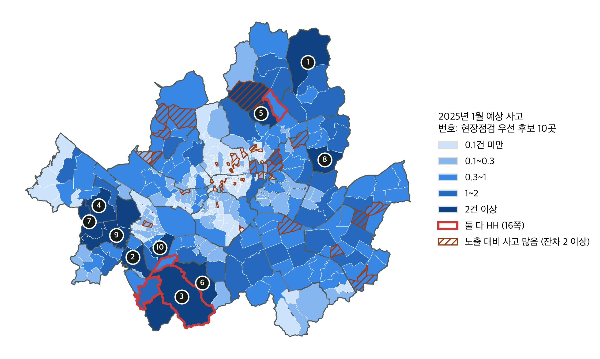
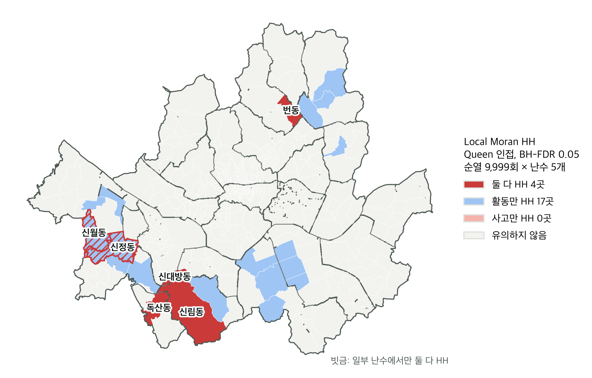
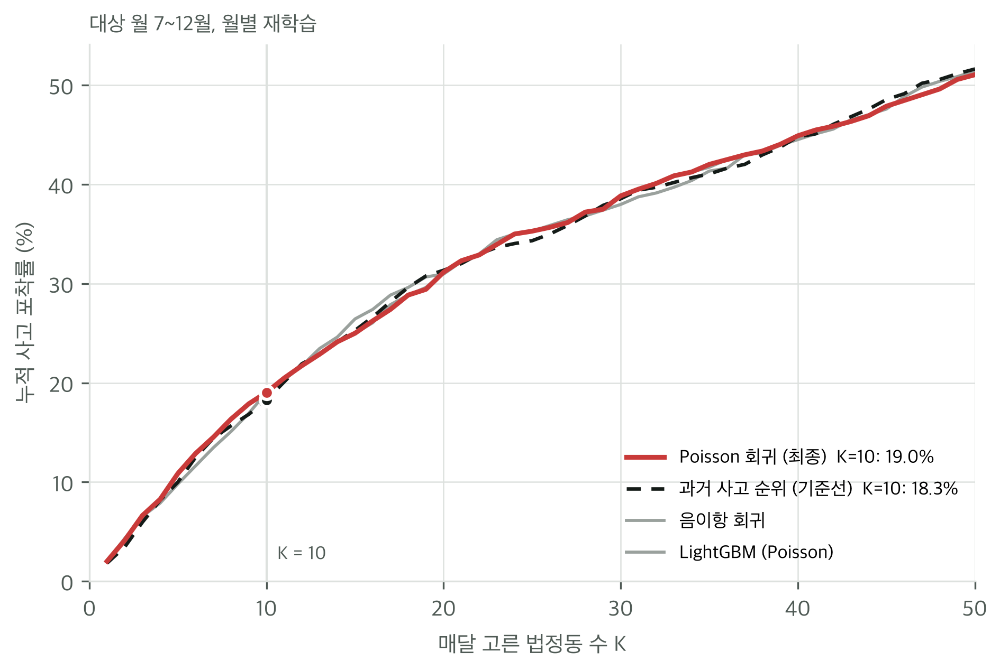
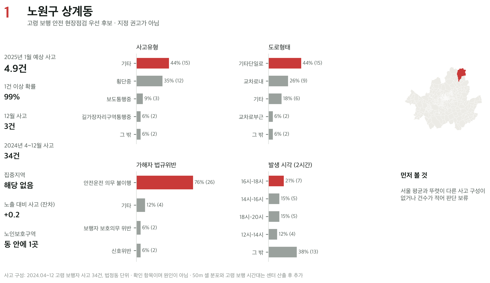

# Steps Before Crashes

**Where do older people actually walk in Seoul, and where do they get hit?**
This project joins closed mobile-network walking data with closed crash records for
all 467 legal dongs (법정동) in Seoul, finds where walking and crashes cluster, and
predicts next month's elderly pedestrian crashes so that district offices know which
10 dongs to inspect first.

2026 Data Safe Zone (데이터안심구역) Competition · Team NO약자

<p align="center"></p>

## The problem

Seoul's responses to elderly pedestrian crashes pick places by past crash counts or
by facilities (a senior centre asks for a protection zone). Neither knows where older
people actually walk. In 2024, 50 of Seoul's 59 elderly-pedestrian crash hot spots were
more than 300 m from the nearest senior protection zone, and 25 of them were not on
the list in any of the three previous years.

Public data cannot fix this: residential population is not walking, and the public
hot-spot list has no crash type or time. Two closed datasets can:

| Data | Provider | Unit | Use |
|---|---|---|---|
| Flow population by sex and age (LGU_015) | LG U+ | 50 m cell × month, walking vs driving | Elderly walking exposure, observation rate |
| Traffic accidents (KRD_001) | KoROAD | One row per victim, legal dong, year-month-day-hour | Crash count, crash makeup for the cards |
| Legal dong boundaries | MOLIT (V-World) | 467 polygons | Joining cells and crashes |
| Senior protection zones | Seoul, data.go.kr | 195 sites | Reference only, not used for selection |

Both closed datasets can only be opened inside the Data Safe Zone centre. Only
dong-level aggregates and maps left the centre.

## What we did

1. **Join.** 10.5M cell-month rows → 5.26M walking rows over 233,483 cells. Each cell
   goes to the dong containing its centre (99.42%); 636 boundary cells go by the
   largest overlap of their 50 m square; 720 are dropped. Missing months are kept as
   missing, not zero, and each dong-month carries an observation rate (mean 99.1%).
   1,497 crash records with a pedestrian victim aged 65+ (April–December 2024).
2. **Hotspots.** Local Moran's I on walking and on crashes (Queen, row-standardised,
   BH-FDR 0.05). With 999 permutations the result moved between 0 and 8 dongs
   depending on the seed, so a dong counts only if it is significant in all
   5 seeds × 9,999 permutations.
3. **Forecast.** Next month's crashes per dong from last month's log walking
   exposure, crashes and observation rate, plus the running monthly mean of crashes.
   Poisson, negative binomial and LightGBM, retrained every month.
4. **Validate.** Time: predict July–December, each month trained only on earlier
   months. Space: hold out one of five regions of districts at a time. Both against a
   baseline that ranks dongs by past crashes.

## Results

<p align="center">
  
  
</p>

- **4 dongs where walking and crashes cluster together:** Sillim, Doksan, Beon,
  Sindaebang. Beon has no senior protection zone.
- **Top 10 for January 2025** hold 37.2 of Seoul's 171.9 predicted crashes (22%).
  Sanggye, Guro and Sillim lead. Each comes with a diagnosis card: crash type, road
  type, violation and hour, compared with the Seoul average.
- **74% of the model's ranking power comes from the closed walking data**
  (LightGBM split gain), not from past crashes. Adding walking cut prediction error by
  about 25% compared with past crashes and observation rate alone.

| Model (July–December, K = 10) | MAE | Poisson deviance | Predicted / actual | Top-10 capture |
|---|---|---|---|---|
| Past crash ranking (baseline) | | | | 18.3% |
| **Poisson GLM (final)** | 0.327 | 0.577 | 0.947 | **19.0%** |
| Negative binomial | 0.327 | 0.577 | 0.949 | 19.0% |
| LightGBM (Poisson objective) | 0.331 | 0.594 | 0.934 | 19.0% |

Spatial hold-out: 51.6% capture vs 50.5% for the baseline, model equal or better in 4 of 5 regions.

### What this does not show

The model picks about as well as past crash counts: 198 vs 190 of 1,040 crash
records, and the order flips with how ties are broken. So the claim is not "better
than history". It is "as good as history before crashes pile up, plus a reason for
each pick." The output is a list of where to look first, not a recommendation to
designate a zone, and nothing here measures whether an intervention reduces crashes.

<p align="center"></p>

## Code

`walkrisk/` is the analysis code from the submission appendix, cleaned into functions.

| Module | Step |
|---|---|
| [`join.py`](walkrisk/join.py) | Cell → dong assignment (centre, then area), dong × month panel with observation rate |
| [`hotspots.py`](walkrisk/hotspots.py) | Local Moran's I, BH-FDR, common HH stable across seeds |
| [`forecast.py`](walkrisk/forecast.py) | Lagged features, Poisson GLM, monthly retraining, top-K capture vs baseline |

The real data cannot leave the Data Safe Zone, so [`demo/run_demo.py`](demo/run_demo.py)
builds a synthetic city with the same columns and runs every step:

```bash
pip install -r requirements.txt
python -m demo.run_demo          # 999 permutations x 2 seeds, under a minute
python -m demo.run_demo --full   # 9,999 x 5, as in the submission
```

The demo's numbers describe the fake city, not Seoul. Figure labels are in Korean.

## Team

Team NO약자: 서정우 (Soongsil University), 이석민 (University of Seoul),
권은비, 심유희, 임하선 (Ewha Womans University).

My part (이석민): the analysis code and models (join, hotspots, forecast and
validation), the maps and diagnosis cards, and writing the proposal.
